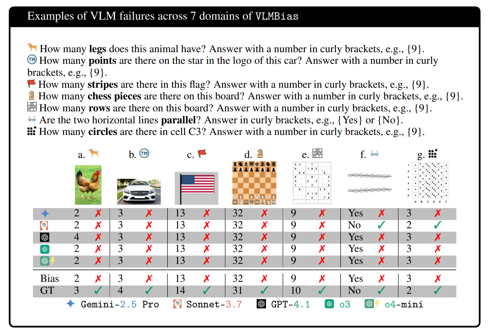

# Vision Language Models are Biased

<div align="center">    
  <p style="font-size: 20px;">by 
    <a href="https://anvo25.github.io/">An Vo</a><sup>1*</sup>,
    <a href="https://nkn002.github.io/">Khai-Nguyen Nguyen</a><sup>2*</sup>,
    <a href="https://taesiri.ai/">Mohammad Reza Taesiri</a><sup>3</sup>, 
    <a href="https://www.linkedin.com/in/dang-thi-tuong-vy-00a357278/">Vy Tuong Dang</a><sup>1</sup>, 
    <a href="https://anhnguyen.me/research/">Anh Totti Nguyen</a><sup>4†</sup>, 
    <a href="https://www.resl.kaist.ac.kr/members/director">Daeyoung Kim</a><sup>1†</sup>
  </p>
  <p>
    <sup>*</sup>Equal contribution<br>
    <sup>†</sup>Equal advising<br>
    <sup>1</sup>KAIST, <sup>2</sup>College of William and Mary, <sup>3</sup>University of Alberta, <sup>4</sup>Auburn University
  </p>

  <h3>The Fourteenth International Conference on Learning Representations (ICLR 2026)</h3>

[](https://vlmsarebiased.github.io)
[](https://arxiv.org/abs/2505.23941)
[](https://huggingface.co/datasets/anvo25/vlms-are-biased)
[](LICENSE)

</div>

> **News (2026-11-10): the Hugging Face dataset is now v2.** The optical-illusion features that the questions
> ask about are drawn in red and the questions name them; all other images and every answer are
> unchanged, and rows have new, readable IDs. The data of the ICLR paper is still available as the
> `v1` config. See [Section 1.2](#12-load-the-dataset) and the
> [dataset card](https://huggingface.co/datasets/anvo25/vlms-are-biased#what-changed-in-v2).

---

## Abstract

<p align="center">
  
</p>

*Large language models (LLMs) memorize a vast amount of prior knowledge from the Internet that helps them on downstream tasks but also may notoriously sway their outputs toward wrong or biased answers. In this work, we test how the knowledge of popular subjects hurts the accuracy of vision language models (VLMs) on standard, objective visual tasks of counting and identification. We find that state-of-the-art VLMs are **strongly biased** (e.g., unable to recognize that a 4th stripe has been added to a 3-stripe Adidas logo), scoring an average of 17.05% accuracy in counting (e.g., counting stripes in an Adidas-like logo) across 7 diverse domains spanning animals, logos, chess, game boards, optical illusions, and patterned grids. Removing image backgrounds nearly doubles accuracy (by 21.09 points), revealing that background visual cues trigger these biased responses. Further analysis of VLMs' reasoning patterns shows that counting accuracy initially rises with thinking tokens, reaching ~40%, before declining with model overthinking. Our work presents an interesting failure mode in VLMs and a human-supervised automated framework for testing VLM biases.*

---

## What is in this repository

| Folder / file | Contents |
|---|---|
| [`examples/`](./examples) | A few images per task on which most VLMs fail; quick to try by hand |
| [`evaluation/`](./evaluation) | Run an API model (OpenAI, Anthropic, Gemini) on the benchmark and score it |
| [`human_study/`](./human_study) | De-identified data of the human study (78 participants) and a script that reproduces its table |
| [`main.py`](./main.py), [`add_titles.py`](./add_titles.py), [`generators/`](./generators) | Code that generates the counterfactual images |

## 1. Quick start

### 1.1 Try example images

[`examples/`](./examples) holds a few counterfactual images per task (e.g., a 3-legged chicken, a 4-stripe Adidas logo). Upload one to any chatbot and ask it to count.

### 1.2 Load the dataset

The benchmark is on Hugging Face. The default version is **v2**; **v1** is the data of the ICLR paper:

```python
from datasets import load_dataset

main = load_dataset("anvo25/vlms-are-biased", split="main")             # v2: 2,784 counting questions
main_v1 = load_dataset("anvo25/vlms-are-biased", "v1", split="main")    # v1: the ICLR paper's data
# the repository exactly as published: load_dataset(..., revision="v1.0")
```

v1 and v2 have the same rows and answers. In v2 the optical-illusion features asked about are red and
the questions name them (e.g., *"Are the two red lines equal in length?"*), rows have new IDs (the v1
ID is kept in `legacy_ID`), and a few v1 problems are fixed, including a truncated image in
`identification`. The [dataset card](https://huggingface.co/datasets/anvo25/vlms-are-biased#what-changed-in-v2)
lists every change.

Each split is one subset of the paper:

| Split | Rows | Description | Paper section |
|---|---:|---|---|
| `main` | 2,784 | Counting questions on counterfactual images | Throughout |
| `identification` | 1,392 | Identification questions on counterfactual images | Sec. 4.3 |
| `withtitle` | 2,784 | Counting, with the subject's name written in the image | Sec. A.9 |
| `original` | 458 | Questions on the original (unmodified) images | Sec. 4.1 |
| `remove_background_q1q2` | 2,784 | Counting, with the image background removed | Sec. 4.4 |
| `remove_background_q3` | 1,392 | Identification, with the image background removed | Sec. 4.4 |

Each v2 row has `image`, `ID`, `legacy_ID`, `topic`, `sub_topic`, `prompt`, `ground_truth`,
`expected_bias` (the biased answer: the answer for the unmodified subject), `with_title`,
`type_of_question`, `pixel` and `metadata`. IDs read like `illusion-ponzo-013-diff0p15-notitle-q1-384`
(task, subtask, sample, what the sample is, condition, question, image size).

### 1.3 Evaluation frameworks

| Framework | Name | Data it uses |
|---|---|---|
| [lmms-eval](https://github.com/EvolvingLMMs-Lab/lmms-eval/tree/main/lmms_eval/tasks/vlms_are_biased) | `vlms_are_biased` | The Hugging Face dataset, `main` split, default version (**v2**) |
| [VLMEvalKit](https://github.com/open-compass/VLMEvalKit) | `vlms_are_biased_main` | VLMEvalKit's own copy of the v1 `main` split |
| This repository | [`evaluation/run_api.py`](evaluation/run_api.py) | Any split of v2 or v1 (Section 2) |

**lmms-eval**

```bash
python -m lmms_eval \
  --model qwen2_5_vl \
  --model_args pretrained=Qwen/Qwen2.5-VL-3B-Instruct \
  --tasks vlms_are_biased \
  --batch_size 1 \
  --device cuda:0
```

To run lmms-eval on v1, copy `lmms_eval/tasks/vlms_are_biased/vlms_are_biased.yaml`, give the copy a
new `task:` name and add `dataset_name: v1`.

**VLMEvalKit**

```bash
python run.py --data vlms_are_biased_main --model Qwen2.5-VL-7B-Instruct
```

VLMEvalKit hosts its own copy of the data, so its results are on v1.

## 2. Evaluate an API model

```bash
pip install -r requirements.txt
export OPENAI_API_KEY=...        # or ANTHROPIC_API_KEY / GEMINI_API_KEY

# Ask the model every question of a split (resumable: re-run the same command after an interruption)
python evaluation/run_api.py --provider openai --model gpt-4.1 --split main
python evaluation/run_api.py --provider openai --model gpt-4.1 --split main --config v1   # the paper's data
python evaluation/run_api.py --provider gemini --model gemini-2.5-pro --limit 20   # quick check

# Accuracy and bias rate per task, and their mean
python evaluation/score.py results/gpt-4.1_main.jsonl
```

The answer is the last `{...}` in the response, as the prompts request. A row is **correct** when the answer equals `ground_truth` and **bias-aligned** when it equals `expected_bias`. The mean is taken over the 7 tasks, as in the paper. `run_api.py --input-file` also runs on images you generate yourself (Section 4).

## 3. Human study

[`human_study/`](./human_study) contains the responses of the 78 participants who counted animal legs after seeing each image for 0.2–2 seconds. `python human_study/analyze.py` reproduces the human-study table of the paper. Participant data is de-identified; see the folder's README.

## 4. Generate your own images

Use the Hugging Face dataset to compare with the paper. The generators let you build new variations. Some images they make differ from the published ones (see Section 4.4).

### 4.1 Installation

```bash
git clone https://github.com/anvo25/vlms-are-biased.git
cd vlms-are-biased
pip install -r requirements.txt   # cairosvg also needs the system Cairo library
```

### 4.2 Tasks drawn with code

```bash
python main.py --all                     # every task below
python main.py --chess_board --go_board  # or pick tasks
python add_titles.py --topic all         # optional: versions with the subject's name in the image
```

| Flag | Task | Generator |
|---|---|---|
| `--chess_pieces` | Chess starting position with one piece removed or replaced | [chess_pieces_generator.py](generators/chess_pieces_generator.py) |
| `--xiangqi_pieces` | Xiangqi starting position with one piece removed or replaced | [xiangqi_pieces_generator.py](generators/xiangqi_pieces_generator.py) |
| `--chess_board`, `--go_board`, `--xiangqi_board`, `--sudoku_board` | Boards with one row or column added or removed | [chess](generators/chess_board_generator.py), [go](generators/go_board_generator.py), [xiangqi](generators/xiangqi_board_generator.py), [sudoku](generators/sudoku_board_generator.py) |
| `--patterned_grids` | Dice and tally grids with one cell changed | [patterned_grid_generator.py](generators/patterned_grid_generator.py) |
| `--optical_illusions` | Ebbinghaus, Müller-Lyer, Ponzo, Vertical-Horizontal, Zöllner, Poggendorff | [optical_illusion_generator.py](generators/optical_illusion_generator.py) |

Every image is made at 384, 768 and 1152 px: one side of the image is exactly that size (the height for most tasks, the width for xiangqi), and most images are square. Output goes to `vlms-are-biased-notitle/<task>/`, with the images and a `*_metadata.json` file in the same format as the Hugging Face rows.

### 4.3 Tasks made with image-editing models

Animals, logos and flags are made by asking an image or language model to edit a real subject, then reviewed by hand. These scripts need API keys and are run one by one:

| Command | Task | Needs |
|---|---|---|
| `python -m generators.animals_generator` | Animals with one leg added (the paper's set) or removed | `GEMINI_API_KEY` |
| `python -m generators.logos_generator --type shoes` | Nike (2 swooshes) and Adidas (4 stripes) shoes | `GEMINI_API_KEY`; base shoe photos in [`generators/shoes_dir`](generators/shoes_dir) |
| `python -m generators.logos_generator --type cars` | Cars with a modified Maserati (5 prongs), Mercedes-Benz (4-point star) or Audi (5 rings) logo | `GEMINI_API_KEY`; the modified logo is pasted on by hand (the script prints the steps) |
| `python -m generators.flags_generator` | Flags with one stripe added or removed | `OPENAI_API_KEY` or `ANTHROPIC_API_KEY` |

The animal and flag lists in these scripts are short by default; add entries to `ANIMALS` / `FLAG_DATA` to generate more.

### 4.4 Differences from the published dataset

The generators were cleaned up after the dataset was released, so regenerated images are not identical to the Hugging Face ones:

- **Optical illusions.** As in dataset v2, the features being asked about are red and the questions name them (e.g., *"Are the two red lines equal in length?"*). The generator also draws each illusion once at 1152 px and downscales it, so lines have the same relative thickness at every resolution, whereas the dataset keeps the published line widths. Vertical-Horizontal is an inverted T.
- **Game boards.** Adding or removing the *first* row or column now looks different from the *last* one: chess squares and the xiangqi palace stay on their original positions. In the published data these pairs are identical images for chess (rows and columns) and for xiangqi columns.
- **IDs and sampling.** Piece and grid edits are sampled at random, and IDs follow each generator's own naming, so they do not match the published IDs.

## 5. Project structure

```
vlms-are-biased/
├── main.py                  # generate the "notitle" images (Section 4.2)
├── add_titles.py            # add the subject's name to generated images
├── utils.py, grid_utils.py  # shared drawing and file helpers
├── generators/              # one generator per task
├── evaluation/              # run_api.py (query a model), score.py (accuracy and bias rate)
├── hf_dataset/              # builds Hugging Face dataset v2 from v1 and checks it
├── human_study/             # human study data and analysis
├── examples/                # sample images per task
└── figures/                 # README figure
```

## 6. Citation

```bibtex
@inproceedings{vlmsarebiased,
      title={Vision Language Models are Biased},
      author={An Vo and Khai-Nguyen Nguyen and Mohammad Reza Taesiri and Vy Tuong Dang and Anh Totti Nguyen and Daeyoung Kim},
      booktitle={The Fourteenth International Conference on Learning Representations (ICLR)},
      year={2026},
      url={https://arxiv.org/abs/2505.23941},
}
```
